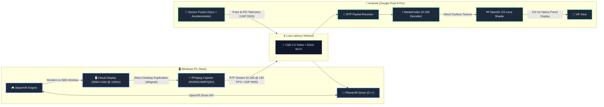

# <p align="center">🥽 PhoneVR</p>

<p align="center">
  <strong>Turn your Google Pixel 8 Pro into an ultra-low-latency 120 Hz PC VR headset for SteamVR.</strong>
</p>

<p align="center">
  <a href="#-technical-specifications"></a>
  <a href="#-technical-specifications"></a>
  <a href="#-architecture"></a>
  <a href="#-architecture"></a>
  <a href="#-license"></a>
</p>

---

## 📖 Overview

**PhoneVR** is a high-performance DIY VR solution designed specifically to harness the cutting-edge hardware of the **Google Pixel 8 Pro** (and other high-resolution 120 Hz Android smartphones) as a dedicated SteamVR Head-Mounted Display (HMD).

Unlike generic cardboard streaming apps, PhoneVR is built with a direct native pipeline:
- **Pixel-Matched Rendering**: Full native panel resolution of **2992×1344** (1496×1344 per eye side-by-side).
- **Native 120 Hz Pipeline**: Locked 120 FPS stream for buttery-smooth motion and minimized motion sickness.
- **Hardware-Accelerated Encoding**: Zero-latency screen capture and encoding via **FFmpeg** utilizing **NVIDIA NVENC**, **AMD AMF**, or **Intel QSV**.
- **Zero-Copy Android Decoder**: Asynchronous **Android `MediaCodec`** surface feeding custom **OpenGL ES** barrel-distortion lens shaders.
- **Physical Optical Tuning**: Real-time IPD and lens separation adjustment using physical phone volume keys while in the headset.
- **Low-Latency Transport**: High-speed UDP packet exchange for telemetry and RTP streaming over USB tethering or 5 GHz Wi-Fi.

---

## 📐 Architecture



---

## ⚡ Technical Specifications

| Parameter | Specification | Notes |
|---|---|---|
| **Panel Resolution** | **2992 × 1344 px** | 1496 × 1344 per eye native OLED rendering |
| **Refresh Rate** | **120 Hz** | Synchronized end-to-end (GPU capture → Phone display) |
| **Horizontal FOV** | **~100°** | Tuned for standard VR viewer optics |
| **Tracking Model** | **3DoF + Neck Pivot** | Low-drift gyro/accelerometer fusion with parallax model |
| **Video Codec** | **H.265 / HEVC** | 40 – 120 Mbps dynamic bitrate |
| **Optical Controls** | **Volume Up / Down** | Sub-millimeter lens and IPD separation tuning (±0.5mm) |
| **Audio** | Supported | Streamed via host Windows audio or Bluetooth |

---

## 📁 Repository Structure

```
PhoneVR/
├── 📁 android/                     # Android Studio Application (Kotlin + OpenGL ES)
│   ├── app/src/main/               # MediaCodec decoder, GL shaders, sensor tracker
│   └── tests-jvm/                  # Standalone byte-accuracy RTP stream test suite
├── 📁 driver/                      # SteamVR C++ OpenVR Driver
│   ├── src/                        # Driver hooks, UDP link, pose mathematics
│   ├── phonevr/                    # SteamVR driver manifest & default settings
│   └── third_party/openvr/         # Valve OpenVR SDK headers (v1.26.7)
├── 📁 pc/                          # Streaming & Network Scripts
│   ├── phonevr_server.ps1          # Master launcher & FFmpeg orchestrator
│   ├── install_driver.ps1          # SteamVR driver registration & firewall setup
│   ├── usb_tether.ps1              # Automated USB tethering network adapter setup
│   └── capture_test.ps1            # Diagnostic desktop capture verification
├── 📁 VDD.Control.25.7.23/         # MikeTheTech Virtual Display Driver (2992×1344@120Hz)
│   ├── install_virtual_monitor.bat # Automated virtual monitor setup script
│   └── Dependencies/               # devcon.exe and custom resolution profiles
├── 🚀 Start_PhoneVR.bat            # One-click desktop launcher
└── 📄 README.md                    # Project documentation
```

---

## 📶 Connection Comparison

| Feature | ⚡ USB 3.0 Tethering (Recommended) | 📶 5 GHz Wi-Fi |
|---|:---:|:---:|
| **Network Latency** | **< 1 ms** | ~4 – 15 ms |
| **Packet Loss / Jitter** | **0% (Rock Solid)** | Occasional wireless jitter |
| **Max Bitrate** | **150+ Mbps** | 60 – 80 Mbps |
| **Device Power** | **Continuous charging** | Rapid battery discharge |
| **Setup** | USB-C data cable | Same local network |

> [!TIP]
> **Pro Tip**: Use a high-quality USB 3.0 Type-C data cable plugged into an elevated USB-C port for the sharpest picture quality (100–150 Mbps) and non-stop playtime.

---

## 🚀 Setup & Installation

### 1. Requirements

- **PC**:
  - Windows 10 or 11 (64-bit)
  - Steam and SteamVR installed
  - [FFmpeg](https://ffmpeg.org/download.html) 6.1+ added to system `PATH`
  - Visual Studio Build Tools (C++17) & CMake 3.15+ (if compiling driver from source)
- **Phone**:
  - Google Pixel 8 Pro (or compatible 120Hz phone) running Android 14+
  - Google Cardboard, VR Box, or similar phone VR headset mount

---

### 2. PC Driver Build & Registration

If not using the prebuilt driver in `driver/phonevr/bin/win64/driver_phonevr.dll`:

```powershell
# Build driver DLL
cd driver
cmake -S . -B build -A x64
cmake --build build --config Release

# Register driver with SteamVR and open firewall ports
cd ..\pc
.\install_driver.ps1
```

---

### 3. Setup Headless Virtual Display (Recommended)

To allow SteamVR to render in native **2992×1344 @ 120Hz** without requiring a physical monitor with those exact specs:

1. Navigate to `VDD.Control.25.7.23\`
2. Right-click `install_virtual_monitor.bat` → **Run as Administrator**.
3. Open Windows **Display Settings** and verify the new virtual display is active at **2992×1344 @ 120Hz**.

---

### 4. Build & Install Android App

Open the [`android/`](android/) directory in Android Studio:
```bash
cd android
./gradlew assembleDebug
```
Deploy the APK to your phone.

> [!IMPORTANT]
> **Phone Settings**:
> - Go to **Settings → Display → Screen resolution** and select **Full resolution (1344×2992)**.
> - Enable **Smooth Display** (120 Hz).

---

### 5. Launch & Connect

#### ⚡ One-Click Launch
Double-click **`Start_PhoneVR.bat`** from the project root folder.

Alternatively, launch from PowerShell:
```powershell
.\pc\phonevr_server.ps1
```

1. Enter your PC's IP address on the phone app and tap **START**.
2. Mount the phone inside your VR headset.
3. In SteamVR Room Setup, select **Seated Mode**.

---

## 🎮 Headset Hotkeys & Tuning

| Action | Control | Function |
|---|---|---|
| **Recenter View** | **Tap Screen** | Zeroes head yaw and recenters orientation |
| **Increase Separation** | **Volume Up** | Moves eye centres outward (+0.5 mm) |
| **Decrease Separation** | **Volume Down** | Moves eye centres inward (-0.5 mm) |
| **VR Navigation** | **Gamepad / Controller** | Use an Xbox, PlayStation, or Bluetooth PC controller |

---

## 🧪 Tests & Verification

Verify the system components independently before flying:

```bash
# 1. Pose maths and UDP loopback unit test
g++ -Isrc driver/tests/test_pose.cpp -o test_pose
./test_pose

# 2. Android H.265 depacketizer byte-accuracy test
cd android/tests-jvm
./run_tests.sh
```

---

## 📜 Licenses & Attribution

- **PhoneVR**: Released under the MIT / Project License.
- **Valve OpenVR**: OpenVR driver headers released under [Valve BSD-3-Clause](driver/third_party/openvr/LICENSE).
- **Virtual Display Driver**: MikeTheTech Virtual Display Driver.
